# defrag-contributions

Your GitHub contribution graph, defragmented.



Every box is one day of your last year. The defragmenter sweeps it from the first day to the last and moves every day you contributed to the front. The days you didn't end up together at the end, as free space. Then it asks if you want to take a day off.

It's a single animated SVG, redrawn every day by a GitHub Action. No server, no dependencies.

## Add it to your profile

1. Copy [`examples/defrag.yml`](examples/defrag.yml) into your profile repo (`github.com/<you>/<you>`) as `.github/workflows/defrag.yml`.
2. Run it once: **Actions → defrag → Run workflow**. After that it runs every night.
3. Put this in your profile `README.md`:

   ```md
   
   ```

## Run it locally

Node 20 or later, nothing to install:

```sh
GITHUB_TOKEN=$(gh auth token) node src/index.js --user <you> --out defrag.svg
node src/index.js --user <you> --out still.svg --freeze 5    # one static frame at 5 s
```

## How it works

- It reads your contribution calendar from the GitHub GraphQL API: one entry per day, with GitHub's own activity level from 1 to 4.
- Days with contributions start as "not optimized yet" (cyan). The sweep reads each one (green) and writes it to the next free spot at the front (red), where it turns "optimized" (blue). The shade still shows how busy the day was.
- Everything is CSS keyframes inside the SVG, so it animates anywhere an image does, including GitHub READMEs.

## Inputs

| Input | Default | |
|---|---|---|
| `github_user_name` | the repo owner | Whose contributions to defragment. |
| `output_path` | `dist/defrag.svg` | Where to write the SVG. |
| `github_token` | the workflow token | For the GraphQL API. |

---

An original drawing in the style of late-90s desktop software, not affiliated with any operating system vendor. Made by [@maximbilan](https://x.com/maximbilan), who builds small weird things with code and AI.
